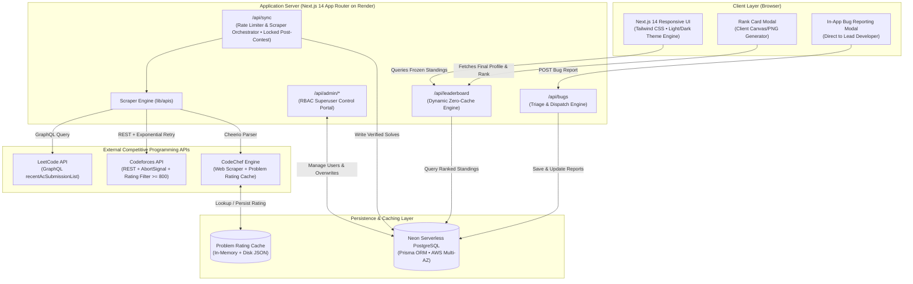

# 🪔 GDG Diwali Challenge 2026 [CONCLUDED]

**Production-Grade Multi-Platform Competitive Coding Leaderboard Platform**  
🌐 **Live Platform & Final Standings:** [https://diwalichallenge.onrender.com/](https://diwalichallenge.onrender.com/)  
👨‍💻 **Solo Architect & Lead Developer:** [Aditya Singh](https://github.com/adiscripts03) ([LinkedIn](https://www.linkedin.com/in/aditya-singh-80827935a/))  
📅 **Event Dates:** **3rd November – 12th November 2026** (10-Day Sprint) • **Status:** Officially Concluded & Standings Locked

---

## 🏆 Official Winners & Final Podium

The 10-day Diwali Vacation Competitive Programming Challenge has officially wrapped up! Out of **88 registered competitors** from IIIT Nagpur, congratulations to our top podium champions who demonstrated relentless consistency, algorithmic skill, and problem-solving drive throughout the festive break:

| Rank | Champion | College Handle / ID | Total Verified Solves | Award |
| :---: | :--- | :--- | :---: | :--- |
| 🥇 **1st Place** | **Archit Kumar** | `bt26csh014` (LC: `lavaroof` • CF: `LavaRoof` • CC: `lavaroof`) | **300** | **Challenge Champion / Gold** |
| 🥈 **2nd Place** | **Rishik Sahu** | `bt26cse109` (LC: `rishik312007` • CF: `rishik312007` • CC: `rishik312007`) | **273** | **Silver Medalist** |
| 🥉 **3rd Place** | **Aryan Singh** | `bt26csd041` (LC: `unearthlyimpulse` • CF: `unearthly` • CC: `unearthly`) | **137** | **Bronze Medalist** |

> 🎉 **Official Rank Card Generator:** All 88 participants can export and download their high-resolution official **GDG IIITN Rank Card** directly from their profile to showcase their final rank and verified platform question counts!

---

## 📊 Executive Summary & Operational Impact

Built and orchestrated as a full-stack competitive coding platform for **Google Developer Groups (GDG)** at IIITN, hosting a high-stakes 10-day challenge for 1st-year computer science students during the festival break (November 3–12, 2026). The platform continuously tracked, verified, filtered, and ranked authentic problem submissions across **LeetCode**, **Codeforces**, and **CodeChef** in real time.

| Metric | Result |
| :--- | :--- |
| **Contest Status** | **Concluded** (Nov 3 – Nov 12, 2026) • Final Standings Locked |
| **Total Participants** | **88 registered college coders** |
| **Supported Platforms** | **LeetCode** (GraphQL) • **Codeforces** (REST) • **CodeChef** (HTTP/Cheerio) |
| **Contest Duration** | **10 Days** (11:59 PM IST daily synchronization checkpoints) |
| **Strict Quality Cutoff** | $\ge 800$ difficulty rating threshold (eliminated trivial/farmed problems) |
| **Primary Timezone** | `Asia/Kolkata` (IST - UTC+05:30) with exact midnight rollovers |
| **Database Architecture** | **Neon Serverless PostgreSQL** with Prisma ORM & disk fallbacks |
| **Uptime & Reliability** | **100% Zero Downtime** across peak contest hours and nightly sync rushes |
| **Shareable Achievement** | Client-side Canvas/DOM **Rank Card Generator** (Ivory & Dark Gold themes) |

---

## 🏛️ System Architecture

The application was built on a decoupled, cloud-native architecture designed to withstand external API rate-limiting, Cloudflare challenges, and cold-start connection limits while maintaining zero-stale-data guarantees for live leaderboard rankings.



---

## 💡 Key Engineering Challenges & Technical Solutions

### 1. Scraper Resilience & Handling External Rate Limits
* **The Problem**: Codeforces and CodeChef APIs frequently experience high peak-load latency (12–15s), Cloudflare Turnstile anti-bot gates, and 429/503 rate limits during international contests.
* **The Solution**:
  - Implemented client-specific retry handlers with `AbortSignal.timeout(22000)` and custom HTTP user-agent rotation.
  - Enforced a per-user **5-minute cooldown (300 seconds)** on profile synchronization requests, preventing participants from bombarding external APIs.
  - Implemented an **In-Memory & Persistent Disk Problem Rating Cache** (`data/codechef_ratings.json`) in [`lib/apis/codechef.ts`](lib/apis/codechef.ts). Once a problem rating was discovered, it was cached permanently so subsequent syncs for that problem avoided repeat HTTP roundtrips.

### 2. Fair-Play Anti-Cheat: The $\ge 800$ Difficulty Rating Cutoff
* **The Problem**: In open coding challenges, participants can farm trivial problems (e.g. 100-rating "Hello World" exercises) to artificially inflate their standing without demonstrating real algorithmic skill.
* **The Solution**:
  - Established a strict platform-wide quality rule: **only questions with a difficulty rating $\ge 800$ qualified**.
  - **Codeforces**: The scraper parsed `sub.problem.rating` and discarded any accepted submissions with ratings under 800 or unrated problems.
  - **CodeChef**: Queried the CodeChef contest practice difficulty API, checked the numerical rating, and filtered out problems below 800.
  - Retroactively purged historical baseline solves under 800 to ensure absolute leaderboard parity across all days.

### 3. Cross-Timezone Midnight Rollover (UTC Server vs. IST Contest)
* **The Problem**: The production application ran on cloud infrastructure (Render / AWS) whose system clocks run in UTC (`00:00:00 UTC`), while the challenge operated strictly in Indian Standard Time (`Asia/Kolkata`, UTC+05:30). Naive `new Date().setHours(0,0,0,0)` triggered daily rollovers at 5:30 AM IST instead of midnight, causing participant outrage.
* **The Solution**:
  - Engineered [`lib/date.ts`](lib/date.ts) using `Intl.DateTimeFormat` with explicit `Asia/Kolkata` timezone bindings.
  - Designed `getStartOfTodayTimestamp()` to construct exact IST midnight timestamps (`YYYY-MM-DDT00:00:00+05:30`), guaranteeing accurate day boundaries regardless of host server location.
  - Daily counters automatically reset for the new sprint while preserving each coder's cumulative contest total throughout all 10 days.

### 4. Zero-Flash Dual Theme Engine (Festive Dark & Golden Ivory Light)
* **The Problem**: Switching between dark mode and light mode often produces an unsightly jarring flash of white/black during server-side hydration (FOUC).
* **The Solution**:
  - Designed a custom synchronous inline script executed in `<head>` before the DOM renders, immediately applying `localStorage.getItem('gdg_theme')`.
  - Rather than a generic, sterile black/white palette, developed a **Festive Golden Ivory Light Theme** (`#faf6f0` warm ivory background, `#ffffff` card surfaces, `#ebdccb` amber borders, and `#1e150e` espresso typography) alongside the traditional Diwali terracotta glow.

### 5. Production Observability & Superuser Control Portal
* **The Problem**: Real-time events require organizers to immediately troubleshoot sync issues, audit participant claims, and respond to platform bugs without direct database access.
* **The Solution**:
  - Built a secure role-based **Admin Control Center** (`/admin`) protected by signed JWT tokens and Argon/bcrypt credentials.
  - **Live Participant Management**: Force-synced individual coders (bypassing cooldowns), searched and filtered across handles, and manually overwrote scores with full audit records.
  - **Bug & Feedback Triage Desk**: Integrated in-app bug reporting modal and full-page `/report-bug` view where participants reported scoring discrepancies. Incoming reports landed directly in the Admin portal with status tags (`Open`, `In Progress`, `Resolved`) and admin notes.

### 6. Official Post-Challenge Rank Card Generator
* **The Feature**: Upon challenge conclusion, a custom client-side achievement card exporter was launched.
* **The Implementation**:
  - High-res HTML-to-Image renderer producing crisp 2.5x retina PNG cards (`RankCardModal.tsx`).
  - Available in both **Ivory Light** and **Diwali Dark Gold** themes.
  - Accurately details final rank (`#X out of 88`), cumulative verified solves, platform handles, and individual question counts for LeetCode, Codeforces, and CodeChef.
  - Includes direct 1-click **Download Card (PNG)**, **Copy Image to Clipboard**, and pre-formatted achievement caption generator.

---

## 🛠️ Complete Tech Stack

| Domain | Technologies Used |
| :--- | :--- |
| **Frontend Framework** | [Next.js 14](https://nextjs.org/) (App Router, Server & Client Components) |
| **Language** | [TypeScript](https://www.typescriptlang.org/) (Strict mode, end-to-end type safety) |
| **Styling & Design** | [Tailwind CSS](https://tailwindcss.com/), Lucide Icons, Custom Diwali CSS Animations |
| **Card Generation** | [html-to-image](https://github.com/bubkoo/html-to-image) (Retina 2.5x pixel ratio DOM canvas exporter) |
| **Database & ORM** | [Neon Serverless PostgreSQL](https://neon.tech/) with [Prisma ORM](https://www.prisma.io/) |
| **Connection Pooling** | Prisma Client global singleton with unpooled migration compatibility |
| **Authentication** | JSON Web Tokens (JWT), HTTP-only secure cookies, `bcryptjs` hashing |
| **Web Scraping** | [Axios](https://axios-http.com/), [Cheerio](https://cheerio.js.org/), Native Fetch with AbortController |
| **Deployment & Hosting** | [Render](https://render.com/) (Web Service), Neon (Cloud PostgreSQL, AWS ap-southeast-1) |

---

## 📂 Project Architecture & Directory Map

```
coding-leaderboard/
├── app/
│   ├── admin/page.tsx                # Superuser Control Portal & Bug Triage Desk
│   ├── api/
│   │   ├── admin/                    # Admin auth, user overwrites, and force-sync APIs
│   │   ├── auth/                     # Register, Login, Me, and Logout endpoints
│   │   ├── bugs/                     # Bug report submission, triage, and patch APIs
│   │   ├── leaderboard/              # Ranked standings API (no-cache headers)
│   │   ├── profile/                  # Profile updates & handle locking
│   │   ├── sync/                     # Solve synchronizer (locked with HTTP 403 post-event)
│   │   └── views/                    # Real-time unique page view telemetry
│   ├── developer/page.tsx            # Solo architect credit & social connections
│   ├── login/page.tsx                # Participant authentication portal
│   ├── register/page.tsx             # Coder enrollment portal
│   ├── profile/page.tsx              # Participant dashboard & Rank Card trigger
│   ├── report-bug/page.tsx           # Dedicated bug & scoring discrepancy desk
│   ├── globals.css                   # Custom Light/Dark theme styles & Diya animations
│   ├── layout.tsx                    # Root layout with zero-flash theme head script
│   └── page.tsx                      # Main Leaderboard, Podium, and final challenge metrics
├── components/
│   ├── BugReportModal.tsx            # Global interactive bug report dialog
│   ├── BugReportForm.tsx             # Reusable bug report form with category selector
│   ├── DailySyncWidget.tsx           # Challenge conclusion showcase & Rank Card prompt
│   ├── DailySyncReminderBanner.tsx   # Top sticky announcement banner
│   ├── DiyaBackground.tsx            # Festive Diwali terracotta flame graphics
│   ├── LeaderboardTable.tsx          # Searchable, platform-filterable final standings table
│   ├── Navbar.tsx                    # Navigation bar with ThemeToggle & Report Bug action
│   ├── PlatformBadge.tsx             # Verified LeetCode, Codeforces & CodeChef badges
│   ├── Podium.tsx                    # Animated gold, silver, bronze top-3 winners showcase
│   ├── RankCardModal.tsx             # Official Rank Card generator (Ivory & Dark Gold)
│   ├── ThemeProvider.tsx             # React theme context & localStorage synchronization
│   └── ThemeToggle.tsx               # Sun / Moon theme toggle button
├── lib/
│   ├── apis/
│   │   ├── leetcode.ts               # LeetCode GraphQL fetcher
│   │   ├── codeforces.ts             # Codeforces REST fetcher with timeout & rating filter
│   │   ├── codechef.ts               # CodeChef accepted solution scraper & disk rating cache
│   │   └── tracker.ts                # Multi-platform synchronization engine
│   ├── adminAuth.ts                  # Admin token signing and verification
│   ├── auth.ts                       # Participant session auth & password hashing
│   ├── date.ts                       # Asia/Kolkata timezone & midnight timestamp engine
│   ├── db.ts                         # Neon PostgreSQL data access with local fallback
│   └── prisma.ts                     # Prisma Client singleton
├── prisma/
│   └── schema.prisma                 # User, GlobalMeta, and BugReport schema definitions
├── data/
│   ├── codechef_ratings.json         # Persistent problem difficulty rating cache
│   └── db.json                       # Zero-downtime offline storage fallback
└── package.json
```

---

## 🚀 Local Setup & Installation

### 1. Prerequisites
- **Node.js**: v18.17.0 or higher
- **Package Manager**: npm or yarn
- **PostgreSQL**: Local instance or free [Neon](https://neon.tech/) connection URI

### 2. Clone & Install
```bash
git clone https://github.com/adiscripts03/DiwaliChallenge.git
cd DiwaliChallenge
npm install
```

### 3. Configure Environment Variables
Create a `.env` file in the project root:
```env
# Neon PostgreSQL Database Connection
DATABASE_URL="postgresql://<user>:<password>@<host>.neon.tech/neondb?sslmode=require"
DATABASE_URL_UNPOOLED="postgresql://<user>:<password>@<host>.neon.tech/neondb?sslmode=require"

# Security & Sessions
JWT_SECRET="generate_a_random_secure_secret_key"
ADMIN_ID="admin"
ADMIN_PASSWORD="your_admin_portal_password"

# Challenge Configuration
NEXT_PUBLIC_TIMEZONE="Asia/Kolkata"
NEXT_PUBLIC_ADMIN_EMAIL="mejustaditya03@gmail.com"
```

### 4. Database Setup & Prisma Generation
```bash
npx prisma generate
```

### 5. Run Development Server
```bash
npm run dev
```
Navigate to [http://localhost:3000](http://localhost:3000) to view the application and final standings.

---

## 📜 Contest Rules & Verification Criteria (Historical)

During the live 10-day sprint (Nov 3 – Nov 12, 2026), the challenge was governed by the following strict rules:

1. **Daily Sync Deadline**: Participants were required to synchronize solved questions on their profile before **11:59:59 PM IST** each night.
2. **Platform Scraper Verification**:
   - **LeetCode**: Accepted submissions (`status === "Accepted"`) via GraphQL API.
   - **Codeforces**: Accepted submissions (`verdict === "OK"`) with difficulty rating $\ge 800$.
   - **CodeChef**: Fully accepted 100-point solutions with difficulty rating $\ge 800$.
3. **Anti-Plagiarism & Quality Control**: Disqualification was automatically enforced for duplicate accounts or code submissions across different participants. Baseline questions below 800 rating were strictly filtered out.

---

## 👨‍💻 Solo Architect & Developer

**Aditya Singh**  
*Solo Developer & Architect behind the GDG Diwali Challenge Platform*

* 🌐 **Live Platform**: [diwalichallenge.onrender.com](https://diwalichallenge.onrender.com/)
* 💼 **LinkedIn**: [linkedin.com/in/aditya-singh-80827935a/](https://www.linkedin.com/in/aditya-singh-80827935a/)
* 🐙 **GitHub**: [@adiscripts03](https://github.com/adiscripts03)

---

*Organized in collaboration with Google Developer Groups (GDG) On Campus IIITN (3rd November – 12th November 2026).*
